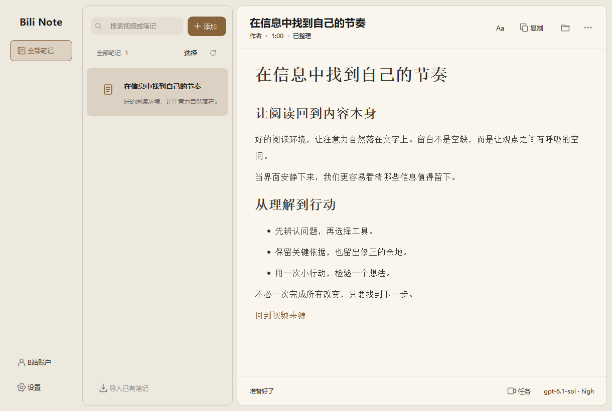
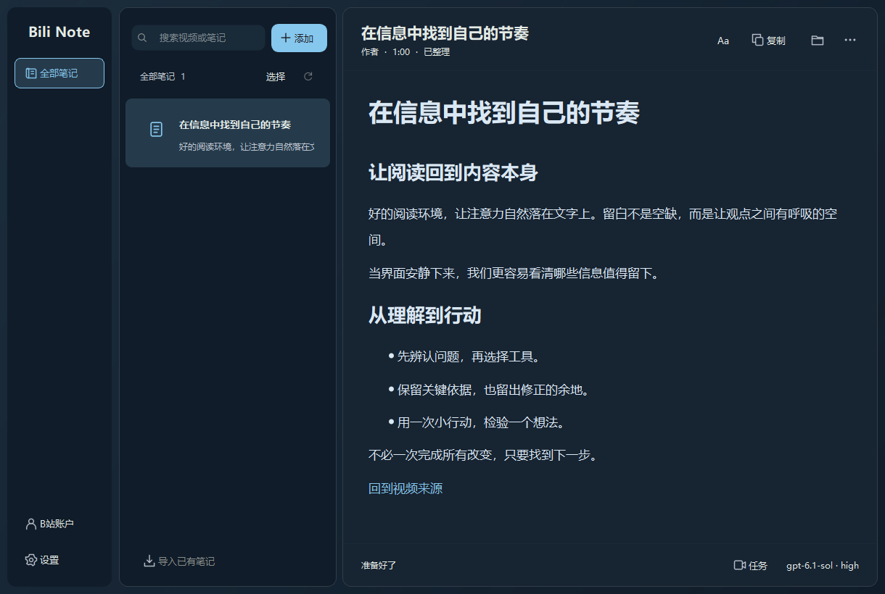

# Bili Note

把 B站视频变成带时间定位、可回查字幕的 Markdown 笔记。Windows 桌面应用，支持批量任务、收藏夹、UP主投稿、多分P和合集选择。

**0.1.0 源码体验版，仅支持 Windows 10/11 x64。** 需要 Python 3.13；AI 总结还需要已登录的 Codex CLI。不是免安装 EXE，也不自带免费模型额度。



## 快速开始

1. 安装 [Python 3.13 64位](https://www.python.org/downloads/windows/)，保留 Python Launcher 选项。
2. 下载本仓库 ZIP 并解压，或克隆仓库。双击 **install.cmd**，等待依赖安装完成，然后确认笔记保存位置：默认在安装目录下创建“生成笔记”，也可浏览选择其他目录；已有用户默认保留原路径。失败时窗口会保留原因，可重试。
3. 双击 **start.cmd**（也可用“启动BiliNote.vbs”）。首次依赖下载需要联网，无需管理员权限。
4. 左下角账户按钮 → 使用 B站 App 扫码登录。
5. 要生成 AI 笔记，先安装并登录 [Codex](https://developers.openai.com/codex/cli/)，在“设置 → 模型与推理”选择你实际可用的模型并测试连接。账号或 API 连接均沿用 Codex 当前配置。内置默认模型只是初始值，不保证你的账号支持。
6. 点击 **＋** 粘贴视频链接，加入任务队列。暂未配置模型时，选择“仅提取正文”，稍后再生成笔记。

双击“创建桌面快捷方式.vbs”可添加桌面入口。需要诊断时执行 `.venv\Scripts\python.exe app\doctor.py`。

## 界面与操作

采用简洁的三栏布局与六套完整视觉搭配，统一图标、字体、配色与留白，保留 Windows 原生窗口控制。

- **标题栏空白处双击**：展开/隐藏“笔记 / 字幕 / 来源”横栏，默认隐藏；当前阅读页不变，悬停显示操作提示。右上角按钮不触发折叠。
- **单击“全部笔记”**：展开/隐藏笔记列表，不清空搜索和当前阅读内容。
- **导航侧栏空白处双击**：隐藏侧栏及笔记列表，进入沉浸阅读；双击窗口左侧窄边缘恢复，列表回到进入前的展开状态。悬停边缘可查看提示。
- 折叠状态自动保存；`Ctrl+F` 会展开导航与列表并聚焦搜索，隐藏时也能找回内容。
- **右下角“任务”**是统一的任务入口，显示处理中与等待数量；也可按 `Ctrl+J` 打开。
- **添加 → 选择生成笔记或仅提取正文 → 开始**。读取方式、画面核对和保存位置收在“更多选项”。
- 仅提取的结果可以直接点阅读区右上角“生成笔记”。
- 首页“模型设置”直接进入模型页；设置窗口“完成”会保存未提交的模型修改，验证失败时保留窗口并显示原因。
- `Ctrl+N` 添加视频，`Ctrl+F` 搜索，`Ctrl+J` 查看任务，`Ctrl+,` 打开设置。
- 点击 **Aa → 外观与阅读**：选择纸间、雾林、晴空、跃动、星航或夜读。点击缩略图即时预览，底部“确认保存”应用；取消、Esc 或点击面板外还原。
- 自定义字体、字号、行距、正文最大宽度与照片；进阶可调整应用底色、正文文字、强调颜色、界面留白和圆角。
- “另存为…”记录个人搭配，随本次确认保存；内置主题可随时恢复。新用户默认纸间，旧用户保留原外观并生成“我的原有外观”。
- 勾选 **应用背景与文章一致**，主界面跟随文章背景；关闭后应用与文章分别使用各自底色。
- **选择背景照片**支持 PNG / JPG / WebP / BMP，本地导入并复制到 `%LOCALAPPDATA%\BiliNote\backgrounds`，不上传网络。照片居中裁切适配窗口，不拉伸。
- **照片透明度**：0% 显示原图，100% 只显示底色，默认 80%；文字和按钮不变透明。照片较复杂时建议提高透明度。
- 支持移除照片、恢复当前内置主题；已有字号与背景保留。移除仅取消使用，不删除用户原图；图片不可用时回退到所选底色。



六套主题与操作说明见[外观主题](docs/外观主题.md)。

## 能做什么

- 优先平台字幕 → 浏览器字幕 → 完整音轨本地转写；字幕够用即停止，不重复转写。
- 批量队列、收藏夹和UP主投稿选取、多P逐集笔记及合集目录。
- 长内容分段整理、逐段对照原文核对后直接组装；保留论据、必要案例、限定与时间。
- 本地阅读、检索、导入、字号与背景调整，关闭窗口后保留托盘后台任务。
- 按需抽帧和视觉模型校正；抽帧不等于全程观看。

## 数据与费用

- 默认笔记：`<安装目录>\生成笔记`，安装时可自定义，之后可在设置中修改。桌面端与命令行共用保存位置。更新时保留已有设置，不自动搬动旧笔记；安装目录不可写时请另选可写目录。
- 登录和设置：`%LOCALAPPDATA%\BiliNote`。B站会话用 Windows DPAPI 加密，仅当前用户可解密；可以在应用内清除。
- small 语音模型：首次转写联网下载到 `%LOCALAPPDATA%\BiliNote\models`，之后复用。转写在本机 CPU 上运行，下载受网络条件影响。
- 总结会把字幕/转写发给你配置的模型服务；开启画面理解还会发送选定图片，并消耗该服务额度。B站登录凭证不送入模型。
- 同一电脑已有旧版 Bili Note 时，会沿用同名本地设置和登录；旧笔记不会复制进仓库。

## 常见问题

- **没有字幕 / 下载失败**：先重新扫码；权限、登录、平台接口变化或网络限制可能导致失败，不保证所有视频可提取。不会用简介代替正文。
- **模型测试失败**：核对 Codex 登录、提供商、模型名和 CLI 兼容性。不会偷偷切换模型。
- **首次转写慢**：首次需下载 small 模型，之后 CPU 转写也需要时间。只需字幕时选“仅字幕，不转写”。
- **浏览器字幕不可用**：在应用中打开专用 Edge 读取通道并登录；无需复制 Cookie。
- **窗口关闭后仍运行**：点 X 会隐藏到托盘，再次双击快捷方式会恢复原窗口，不会重复创建应用。需要完全关闭时，在托盘右键“退出”；运行中任务结束后退出。

## 开发与发布

```powershell
.\.venv\Scripts\python.exe -m unittest discover -s app -p "test_*.py"
.\.venv\Scripts\python.exe scripts/package.py
```

产物为 `dist/BiliNote-windows-source.zip`，采用文件白名单，不包含虚拟环境、模型、会话及私人笔记。GitHub Actions 自动运行 Windows 测试并上传源码包；见[发布指南](docs/发布指南.md)。

MIT 许可；第三方来源见 [THIRD_PARTY_NOTICES.md](THIRD_PARTY_NOTICES.md)。与 Bilibili 无官方关联，请仅处理你有权访问的内容。
