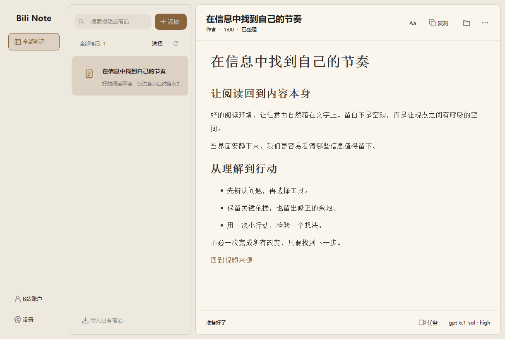
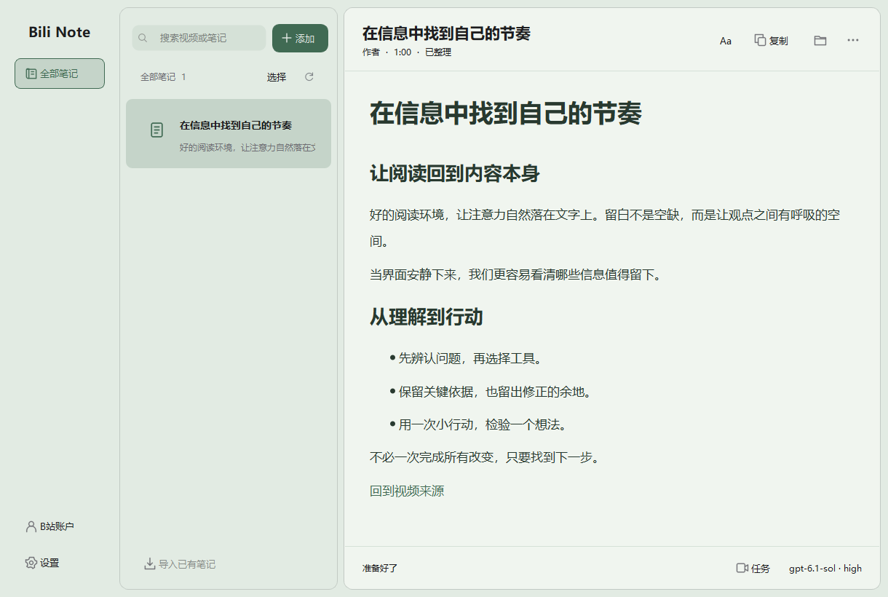
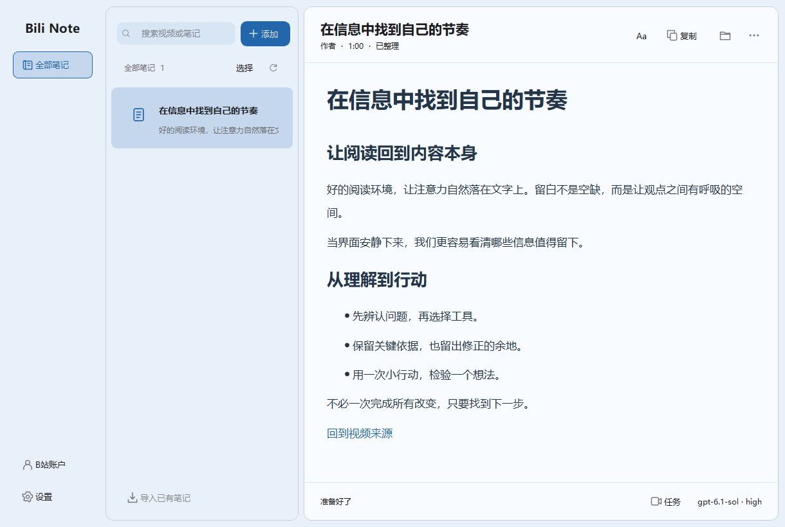
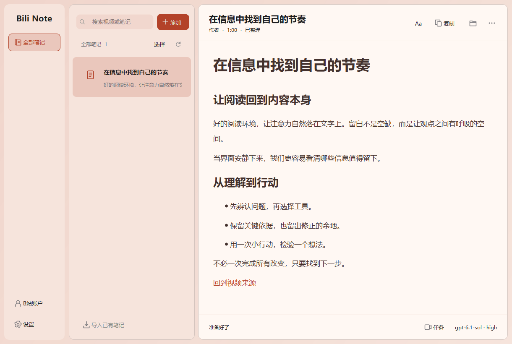
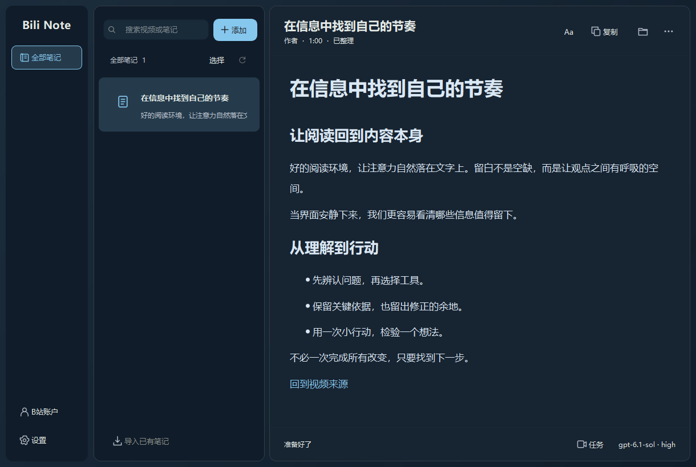
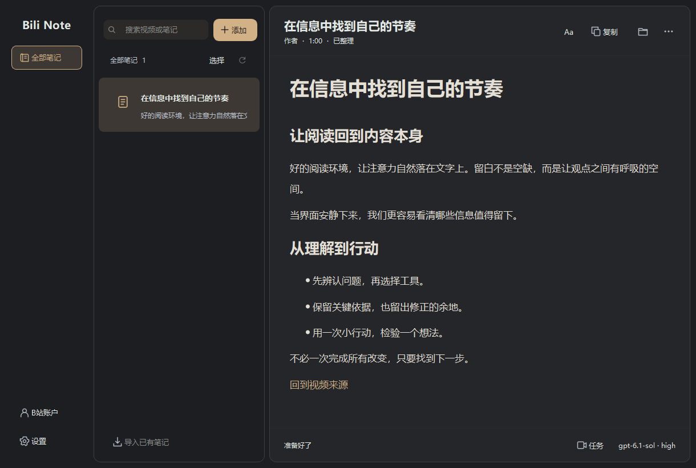
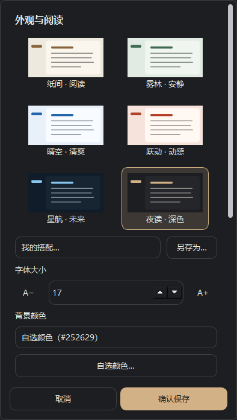
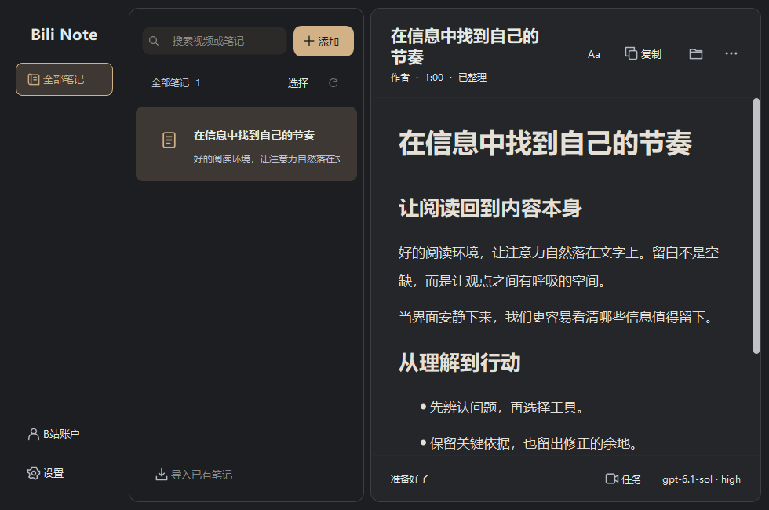
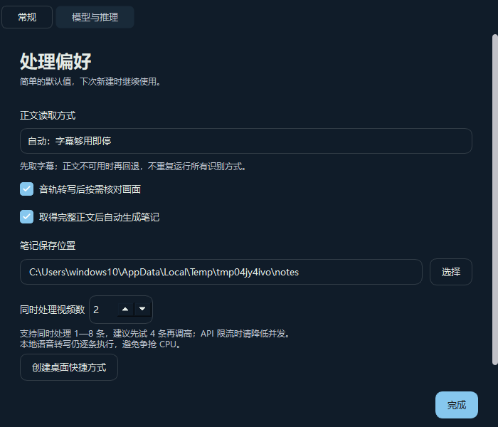
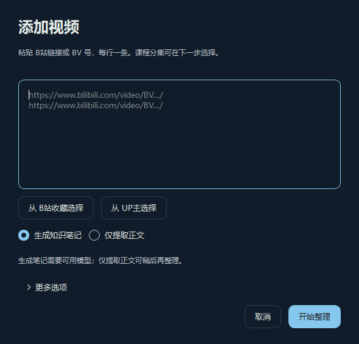

# 外观主题

点击阅读区右上角 **Aa** 打开搭配面板。选择缩略图即可预览，底部“确认保存”应用；取消、Esc 或点击面板外还原。预览期间不会把临时外观写入设置文件。

| 搭配 | 气质 | 正文字体 |
| --- | --- | --- |
| 纸间 · 阅读 | 暖纸白、墨灰、棕金，书页排版 | 宋体 |
| 雾林 · 安静 | 淡灰绿，柔和留白 | 微软雅黑 UI |
| 晴空 · 清爽 | 冷白、浅蓝，轻盈清晰 | 微软雅黑 UI |
| 跃动 · 动感 | 珊瑚与浅桃，外围静态渐变 | 微软雅黑 UI |
| 星航 · 未来 | 深蓝灰、冰蓝，精细线条 | 微软雅黑 UI |
| 夜读 · 深色 | 深石墨、柔白、低饱和暖色 | 微软雅黑 UI |

主题覆盖主界面、图标颜色、选中态、阅读区和弹窗。所有主题沿用相同操作布局，不使用持续运动背景。

## 自己搭配

- 常用：文章底色、背景照片、照片透明度、字体、字号、行距、正文最大宽度。正文最大宽度在窗口较宽或沉浸阅读时生效，小窗口自动适应。
- 进阶：应用底色、正文文字色、强调色、界面留白、控件圆角。文字色与底色建议保持明显对比。
- “应用背景与文章一致”开启时，应用使用文章底色与照片；关闭后分别设置底色，照片只在阅读区显示。
- “另存为…”为当前搭配命名，随后点击“确认保存”。已有同名搭配会先询问是否替换。再次使用时从“我的搭配…”选择。
- “恢复当前内置主题”恢复所选主题原始值；取消可以撤销本次恢复。内置主题不会被自定义覆盖。
- 新用户默认使用纸间；旧设置保留为“我的原有外观”。切换不修改笔记文件，也不清空搜索、切换文章或改变侧栏折叠状态。
- Ctrl+滚轮仍可快捷调整字号，并直接保存。

照片仅保存本机；移除照片不删除源文件。主题保存的是本机图片副本路径，不提供跨电脑主题导出。

## 实际窗口预览

以下均使用测试笔记，不含私人内容。

